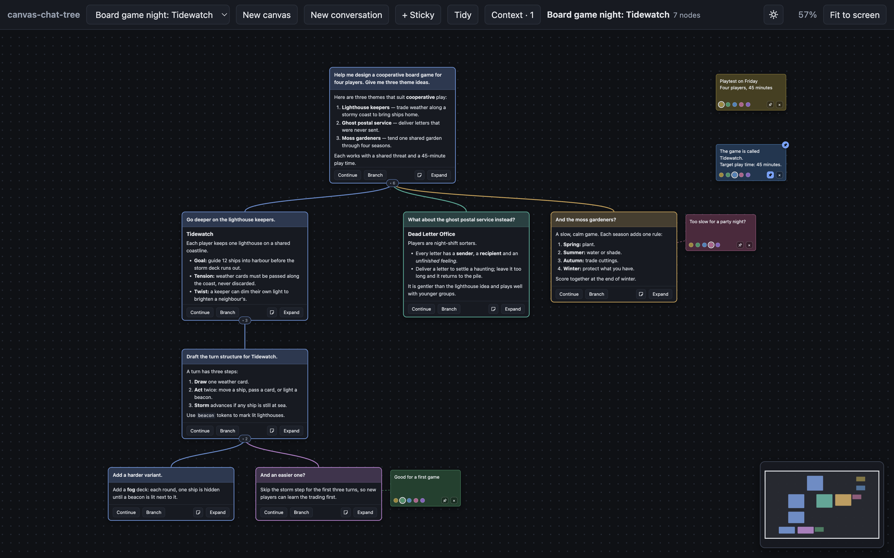
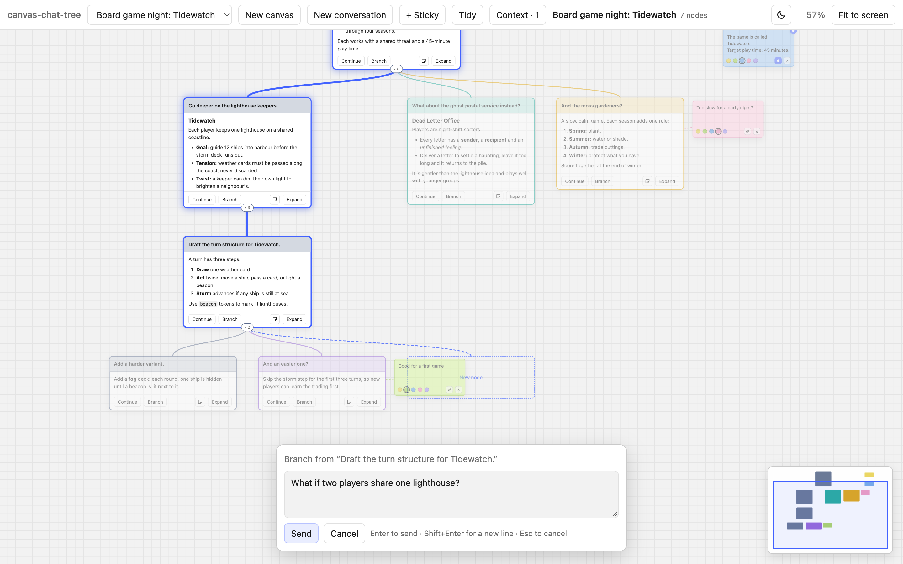
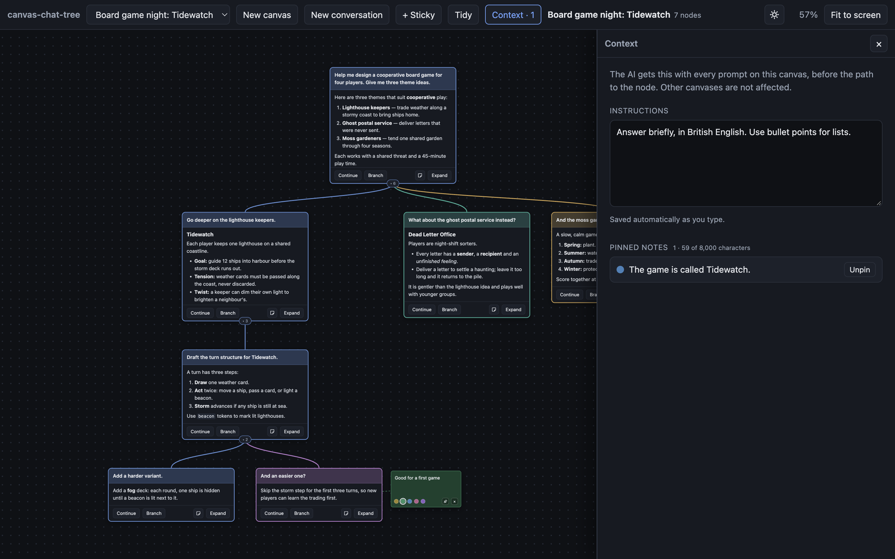

# canvas-chat-tree

An infinite canvas where every AI chat exchange is a node, and any node can be branched.



## Why

Linear chat gets messy when you think in branches. You ask a question, get an answer, and want to explore two follow-ups without one polluting the other. In a normal chat you either scroll up and lose your place, or open a new chat and lose the context.

canvas-chat-tree lays the conversation out as a tree on a canvas. Each exchange (your prompt plus the AI's reply) is a card. You can continue from any card or branch from it, and the AI only ever sees the path from the root to the card it is answering, never the sibling branches.



The screenshots show a demo canvas with invented content.

## Features

**Conversations**

- Every exchange is a node card; **Continue** adds a follow-up below, **Branch** starts a new direction beside it
- The AI answers using only the path to that node, so branches never leak into each other
- Replies stream in word by word, with Markdown (bold, headings, lists, code), sanitised
- A reload or a second tab mid-reply keeps the text written so far; a failed reply shows the error and a Retry button
- **Expand** opens a reader panel with the full prompt and reply, a Copy button, and Continue and Branch

**Canvas**

- Two-finger scroll or mouse wheel pans; pinch or Ctrl/Cmd + wheel zooms towards the cursor; fit to screen
- Each branch family gets its own accent colour on card borders and edges
- Click a card's header to highlight the active path back to the root; everything else dims
- Collapse a node to hide its descendants (remembered per canvas in your browser)
- A minimap in the corner; click or drag in it to move
- Drag cards by their header; **Tidy** rearranges everything into a clean tree, with Undo
- Dark and light themes; follows your system until you choose

**Notes and context**

- Sticky notes: free on the canvas or attached to a card, in five colours
- Canvas instructions: free text the AI gets with every prompt on that canvas
- Pin a sticky to send it to the AI as context for every prompt on that canvas; unpinned stickies are never sent



**Other**

- Several canvases, with a switcher
- Optional password protection (HTTP Basic Auth)

## Live demo

There is no public demo. The author's own instance is password-protected, because every prompt spends API credits. To try it, run it locally or deploy your own copy; both take a few minutes.

## Tech stack

- Node.js (20 or newer) + Express
- Postgres, via the `pg` driver
- Anthropic API, via `@anthropic-ai/sdk`, streamed to the page over Server-Sent Events
- Frontend: a single HTML file ([public/index.html](public/index.html)) using Preact + htm and micromark from esm.sh, with no build step

The schema (three tables: `canvases`, `nodes` and `stickies`) is created automatically when the server starts. Schema changes are additive only.

## How the AI's context is built

For every prompt, the AI gets, in this order:

1. A short base system prompt.
2. The canvas instructions, if any.
3. The pinned notes, newest first, up to 8,000 characters in total. The Context panel warns when a note does not fit and names it.
4. The path: each ancestor's prompt and reply from the root down, ending with the new prompt.

Items 1 to 3 are sent as system blocks marked for prompt caching.

## Run locally

You need Node.js 20 or newer, a Postgres database and an Anthropic API key.

```bash
npm install
```

Set the environment variables listed in `.env.example`:

| Variable | What it is |
| --- | --- |
| `DATABASE_URL` | Postgres connection string |
| `ANTHROPIC_API_KEY` | Your Anthropic API key |
| `APP_PASSWORD` | Optional. When set, everything except `/api/health` requires HTTP Basic Auth (any username, this password) |
| `ASK_MODEL` | Optional. Model used for replies. Defaults to `claude-sonnet-5-5` |
| `PORT` | Optional. Defaults to `8080` |

The server reads them from the process environment (it does not load a `.env` file by itself). Then:

```bash
npm start
```

Open http://localhost:8080. `GET /api/health` returns `{ "ok": true, "db": true, "model": "..." }` when the database is reachable.

## Deploy on Railway

1. Create a Railway project with a Postgres service and an empty service for the app.
2. On the app service, set `DATABASE_URL` (reference the Postgres service), `ANTHROPIC_API_KEY`, `APP_PASSWORD` and optionally `ASK_MODEL`.
3. From the repo folder, run `railway link` and choose the project and the app service, then `railway up`.
4. Generate a public domain for the app service and open `/api/health` on it. The server listens on `PORT`.

Set `APP_PASSWORD` before sharing the URL with anyone: without it, anybody who finds the page can spend your API credits.

## API

| Method and path | What it does |
| --- | --- |
| `GET /api/health` | `{ ok, db, model }`. Always open, even with a password set |
| `GET /api/canvases` | List canvases with `node_count`, newest first |
| `POST /api/canvases` | Create a canvas. Body: `{ title? }` |
| `GET /api/canvases/:id` | `{ canvas, nodes, stickies }` |
| `PATCH /api/canvases/:id` | Save the canvas instructions. Body: `{ instructions }` |
| `PATCH /api/canvases/:id/positions` | Save many node positions at once. Body: `{ positions: [{ id, x, y }] }` |
| `POST /api/canvases/:id/nodes` | Create a node. Body: `{ parent_id, prompt, x, y }`. Returns it as `pending`, then answers in the background |
| `GET /api/nodes/:id` | One node, including the partial reply while it is being written |
| `GET /api/nodes/:id/stream` | Server-Sent Events for a node being answered: `snapshot`, `delta`, then `done` or `failed` |
| `PATCH /api/nodes/:id` | Save a position. Body: `{ x, y }` |
| `POST /api/nodes/:id/retry` | Ask the AI again for a node in `error` |
| `POST /api/canvases/:id/stickies` | Create a sticky. Body: `{ node_id?, x, y, color?, content? }` |
| `PATCH /api/stickies/:id` | Update a sticky. Body: any of `content`, `color`, `x`, `y`, `node_id`, `in_context` |
| `DELETE /api/stickies/:id` | Delete a sticky |

## Roadmap

Planned for v0.3:

- File and image uploads
- Web search
- Model picker and answer style (prose or concise)
- Dictation
- Connectors to your own tools (MCP)
- Importing ChatGPT history
- Projects that group several canvases
- Canvas export
- Multi-user accounts

Also open: richer Markdown (tables, syntax highlighting), deleting nodes and renaming canvases.

## Licence

MIT. © 2026 Gustav Andersson. See [LICENSE](LICENSE).
